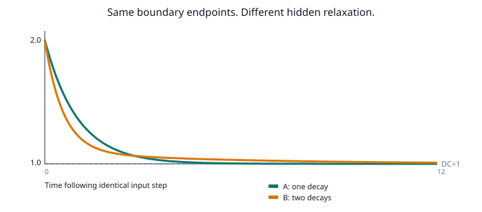

# G3 — The outer lens: a coarse box can learn a *dynamical response*



**2026-10-20 · exploratory, CPU · branch `sol/outer-response-lens-g3`**

Motivated by the PhiWorld2 detour, the original SuperWeights-as-lenses proposal, BrainBoxClaude G5's growth hierarchy, and the *folds as fractals* paper. This is an established linear-systems concept applied to a deliberately small material-memory thought experiment, **not a new algorithm or competitive AI result**.

## Why this differs from ordinary block means

A parent may summarize a child by its weight sum. But different interiors can share the same sum while having different responses to time-varying questions. The correct mathematical object is an **effective boundary transfer function**, not necessarily a scalar block average.

Two accessible boundary ports (left voltage controlled, right grounded), and **two hidden capacitive nodes** in parallel:

```
            gL1      C1      gR1
  left ------/---[ hidden ]---/------ right ground
       \    gL2      C2      gR2    /
        -----/---[ hidden ]---/-----
   observe only left-side current i(t)
```

There are exactly two externally written material histories:

| History | Hidden path 1 (gL,gR) | Hidden path 2 (gL,gR) |
| --- | --- | --- |
| A | (1,1) | (1,1) |
| B | (0.2,0.2) | (1.8,1.8) |

All capacitances are C=2. Both histories have **the identical full DC two-port map** and **the identical instantaneous feedthrough**:

```text
  Y_DC = sum_i (gL_i*gR_i)/(gL_i+gR_i) = 1
  Y_instant = sum_i gL_i = 2
```

Indeed both left and right total conductances are 2. A has one distinct relaxation rate; B has two. A unit voltage step gives, at continuous elapsed time t (sampling uses an exact exponential state update),

```text
  i_A(t) = 1 + exp(-t)
  i_B(t) = 1 + 0.1 exp(-0.2 t) + 0.9 exp(-1.8 t)
```

So the current begins at 2 and eventually becomes 1 in BOTH histories, but differs by up to approximately **0.155** between them in the meantime.

For a path's hidden state `x_i`:

```text
  a_i = exp(-(gL_i+gR_i)*dt / C_i)
  x_i[t+1] = a_i*x_i[t] + (1-a_i)*gL_i/(gL_i+gR_i)*u[t]
  i[t] = sum_i gL_i*(u[t]-x_i[t])
```

The frequency-domain boundary admittance is the **Schur complement** after eliminating the hidden capacitive nodes:

```text
  Y(s) = sum_i (gL_i - gL_i^2/(gL_i+gR_i+s*C_i))
```

It is the frequency-dependent part—unseen in a DC block total—that reveals the hidden material difference. Reinitializing the fast capacitor states between probes does **not** erase the persistent difference in the conductances.

## Trained outer lens, no internal-state access

We deliberately create histories A and B by setting their conductances. **No plasticity rule learns those material writes.** The outer reader only gets 2,500 pairs of externally observed `u(t),i(t)` and must learn to predict unseen drives. It does not see or fit individual conductances.

Classical system-identification controls:

- **DC scalar:** 1 coefficient; no temporal memory.
- **FIR-3 / FIR-5:** 3 or 5 coefficients, only delayed inputs.
- **ARX(1):** 3 coefficients; 1 recurrent output lag.
- **ARX(2):** 5 coefficients; 2 recurrent output lags.

The ARX models recursively forecast their own heldout outputs. They NEVER receive the correct previous output during testing.

The five-coefficient ARX(2) can express both histories exactly in the noiseless linear toy. A one-pole ARX(1) can express A exactly but cannot exactly express B; this provides a built-in order check.

### Exploratory mean heldout RMSE

Five independent probe seeds × three independent test drive types, aggregated within each history. The two material states themselves do **not** change across seeds.

| Noise in training boundary measurements | History | DC (1) | FIR-5 (5) | ARX-1 (3) | ARX-2 (5) |
|---|---|---:|---:|---:|---:|
| 0 | A | .52884 | .26048 | ~0 | ~0 |
| 0 | B | .46525 | .22714 | .01064 | ~0 |
| .1% | A | .52884 | .26048 | .00013 | .00011 |
| .1% | B | .46525 | .22714 | .01065 | .01053 |
| 1% | A | .52884 | .26047 | .00604 | .00240 |
| 1% | B | .46525 | .22717 | .01135 | .01075 |

**Both a static DC reader and the instantaneous limit are blind to the two histories.** In 200 paired classification trials (two **known** candidates and 5% test measurement noise), the DC reader gets 50%, while the fitted ARX readers achieve 100% with a long, fixed heldout drive. This is a deliberately *easy* classification protocol, NOT general recognition.

**Important failure/qualification:** under 0.1% or 1% noise in the *training* boundary signals, the two-pole fit for B no longer obtains the near-zero noiseless error; inferring distinct slow poles is ill-conditioned. A robust implementation would need proper experiment design, regularization, model-order selection and dynamic drift tests. Matching coefficient counts does not equalize recurrent state or running time.

## Connection to the uploaded folds-as-fractals paper

Wang et al., *Neuro-evolutionary evidence for a universal fractal primate brain shape* (arXiv:2209.08066v6), coarse-grained the folded cortical morphology of **11 primate species**, finding an approximately common shape scaling with **fractal dimension 2.5**. Its coarse-graining removes folds smaller than a selected spatial scale; cortical thickness provides a smallest-feature scale. The paper is about **morphometry**, not dynamical transfer functions, PAC, addressing, neural credit or learning. Its value here is as motivation for asking what remains meaningful when a complex object is observed at a coarser scale.

This model is also **not PhiWorld2**. PhiWorld has nonlinear second-order field dynamics, a double-well potential and amplitude-dependent propagation; the G3 medium is passive, dissipative and linear. The shared question is which aspects of the inner world are visible—and usefully predictable—through a restricted outside interface.

## How to reproduce

Requires only NumPy (already in the BrainBoxSol requirements):

```bash
python outer_lens.py --out results/outer_lens.json
python -m unittest -v test_outer_lens
python sweep_outer_lens.py --out results/outer_lens_sweep.json
```

The GitHub Actions workflow runs the tests and five-seed sweep, and uploads raw JSON receipts.

## Honest verdict and the next gate

**PASS, narrowly:** a frequency-dependent outer response distinguishes two materially different interiors even when their DC and instantaneous responses are *exactly identical*. A fitted five-coefficient recursive reader predicts heldout boundary transients much better than an equally sized short FIR reader.

**NOT PASSED:** autonomous experience-driven writing; stable identification under more severe measurement noise; out-of-distribution material changes; task-relevant continual learning; superiority over a quantized state snapshot; better performance per watt/time/byte.

**Next falsifiable question:** can the box develop slow material memory from sequential inputs and maintain useful *external response behavior* under unrelated subsequent learning? Measure it against simple recurrent memories and snapshots under a matched hardware budget. Only then reconnect it to PhiWorld's nonlinear self-organizing dynamics.
